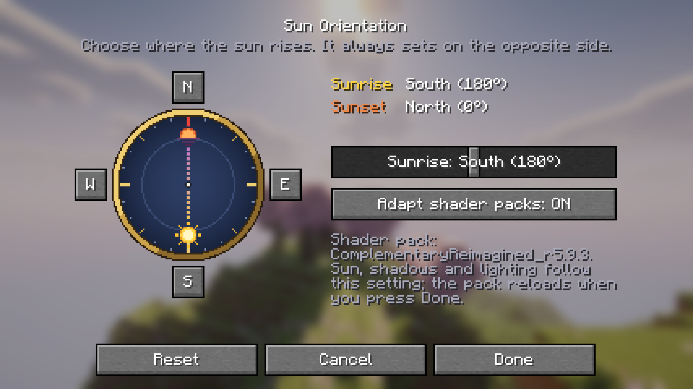

<p align="center">
  
</p>

<h1 align="center">Sun Orientation</h1>

<p align="center">
  <b>Choose where the sun rises.</b> South, north, west or any angle — the sky, shadows and shader lighting follow.<br>
  Fabric · NeoForge · Quilt · Minecraft 26.1.2, 26.2 and 26.3 · client-side only
</p>

<p align="center">
  
</p>

## Features

- **Any sunrise direction.** Pick North, East, South or West with one click, or any angle from 0° to 359°.
  The sun always sets on the opposite side and passes through the zenith at noon. Default: sunrise in the south.
- **Everything moves together.** Sun, moon and stars, the orange sunrise glow, and the sunrise tint of the fog.
- **Shaders (Iris).** Sun and moon positions, `shadowLightPosition`, the shadow map and the culling of shadows
  are rotated consistently, so shadows fall away from the sun you see.
- **Complementary, BSL and similar packs.** These packs compute the sun direction in their own GLSL code
  instead of using Iris' uniforms. Sun Orientation adapts that code when the pack loads, so block lighting,
  sky scattering and reflections match too. It can be turned off.
- **Live preview.** A compass screen (Mod Menu on Fabric, the mods list on NeoForge): click or drag on the compass, use the presets or the slider,
  and watch the sky change behind the menu. Hold Shift for free angles.
- **Purely visual.** It does not change the time of day, the day length, world generation, servers or other
  players. Works in singleplayer and on any server; nothing to install server-side.
- **No hard dependencies.** Iris and Mod Menu are optional. English and Spanish translations.

## Requirements

| | |
| --- | --- |
| Minecraft | 26.3, 26.2 or 26.1.2 — download the jar for your version and loader |
| Loader | Fabric Loader 0.19.5+, Quilt Loader 0.31+ (uses the Fabric jar) or NeoForge (26.3.0.76+, 26.2.0.57+, 26.1.2.71+) |
| Java | 25 |
| Optional | [Iris](https://modrinth.com/mod/iris) (shaders): 1.11.7+ on 26.3, 1.11.4+ on 26.2 and 26.1.2 · [Mod Menu](https://modrinth.com/mod/modmenu) (config screen on Fabric/Quilt) |

Jar names: `sun-orientation-<version>+<minecraft>-<loader>.jar`, e.g. `sun-orientation-1.0.0+26.3-neoforge.jar`.

## Configuration

Open **Mods → Sun Orientation → ⚙** (Mod Menu on Fabric/Quilt) or **Mods → Sun Orientation → Config** (NeoForge). Or edit `config/sun_orientation.json`:

```json
{
  "sunriseBearing": 180,
  "adaptShaderPacks": true
}
```

`sunriseBearing` is a compass bearing: `0` north, `90` east (vanilla), `180` south, `270` west.
When you press **Done** with a shader pack active, the pack is reloaded so its lighting uses the new angle.

## Compatibility

| | Status |
| --- | --- |
| Vanilla sky (no shaders) | Tested in game on every Minecraft version and loader, including the NeoForge mods list → Config button |
| Iris 1.11.7 (26.3) | Tested in game on Fabric, Quilt and NeoForge: uniforms, shadow matrix and culling checked numerically |
| Iris 1.11.4 (26.2 and 26.1.2) | Tested in game on Fabric and NeoForge, same checks |
| Complementary Reimagined r5.9.3 | Tested in game (default settings): sun, shadows, lighting |
| Other shader packs | Sun position and shadows follow if the pack uses Iris' uniforms. Packs that compute the sun in GLSL with a different formula keep east–west lighting. |
| Nuit | Compatible. Custom skyboxes from Nuit resource packs draw their own sun and are not rotated. |
| Distant Horizons | Not tested |

If something does not follow the setting, `logs/latest.log` lists every hook that ran (`[SunOrientation] hook active: …`).

## Building

JDK 25 is required; the Gradle wrapper downloads Gradle 9.7.1.

```bash
./gradlew build
```

One source tree builds every Minecraft version and loader with [Stonecutter](https://stonecutter.kikugie.dev/):
each build node (`versions/<minecraft>-<loader>`) writes its jar to `versions/<node>/build/libs/` and copies it to
`release/`. `./gradlew test` runs the geometry tests (35 cases, every rotated piece for 12 directions) on every node.
In-game tests (Fabric client gametest, a NeoForge equivalent, and the Fabric jar on Quilt) are described in
[docs/TECHNICAL.md](docs/TECHNICAL.md).

## License

[MIT](LICENSE) © 2026 Edgar_G. Inspired by the idea of [ClassicSunRotation](https://github.com/MinecraftAtHome/ClassicSunRotation)
(MIT); no code from Minecraft, Iris or shader packs is included.
